<div align="center">

# Bash Mastery

**Learn Bash from your first command to production automation — interactively, in the browser.**

A free, open-source course with 95 hands-on lessons, a sandboxed Bash terminal, live visualizations, auto-checked exercises and 15 real-world projects. Nothing to install and no account needed; your progress stays in your browser.

[](https://nextjs.org)
[](https://react.dev)
[](https://www.typescriptlang.org)
[](https://tailwindcss.com)
[](#testing)

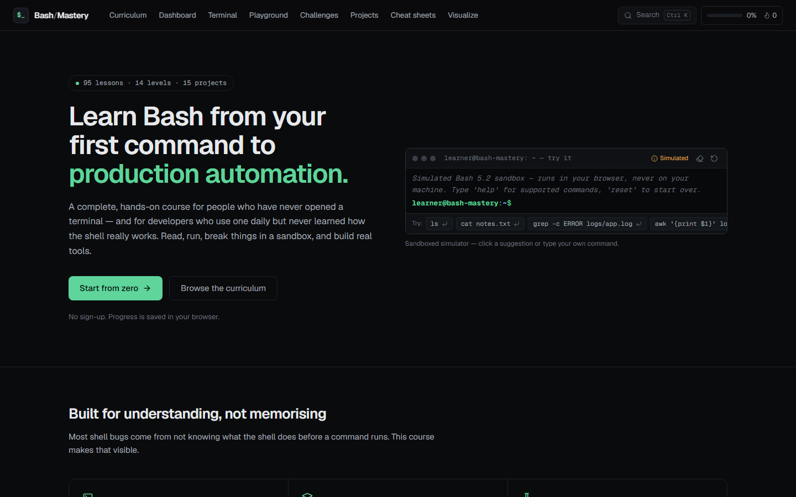

</div>

---

## Contents

- [Why Bash Mastery](#why-bash-mastery)
- [Features](#features)
- [Screenshots](#screenshots)
- [Curriculum](#curriculum)
- [Getting started](#getting-started)
- [How it works](#how-it-works)
- [Project structure](#project-structure)
- [Writing content](#writing-content)
- [Testing](#testing)
- [Contributing](#contributing)

## Why Bash Mastery

Most Bash tutorials are either a list of commands to memorise or a reference manual. Bash Mastery explains what the shell is **actually doing** — tokenising, expanding, splitting, forking — and lets you try every idea right away in a real-feeling terminal, without touching your own machine.

- **Beginners** start from "what is a terminal?" and work up step by step.
- **Developers** who use the shell every day finally learn quoting, expansion order, error handling and how processes work.
- **DevOps engineers** practise robust scripting, deployments, monitoring and CI/CD.

## Features

| | |
|---|---|
| 📚 **95 lessons in 14 levels** | Objectives, explanations, runnable examples, common mistakes, practice and a challenge in every lesson. Covers Bash vs POSIX `sh` and GNU vs BSD/macOS differences. |
| 🖥️ **Sandboxed Bash simulator** | A Bash 5.2-compatible interpreter written in TypeScript, with a virtual filesystem, pipes, redirection, job control, traps, arrays, `awk`, `sed`, `grep`, `find` and about 80 commands. It never runs `eval` and never touches your computer. |
| ✍️ **Code playground** | Edit and run scripts with arguments and stdin, and get a line-by-line **Explain** walkthrough. |
| 🔬 **18 interactive visualizations** | Command execution, PATH lookup, pipelines, file descriptors, expansion stages, subshells, signals, job control, permissions, cron and more. |
| ✅ **Auto-checked exercises** | Multiple choice, predict-the-output, find-the-bug, fill-in-the-blank, write-a-command and complete-the-script. Answers run in the simulator, hints unlock step by step, and solutions appear only after honest attempts. |
| 🛠️ **15 guided projects** | From a file organizer to a production-grade CLI. Each has requirements, steps, hints, tests, edge cases and a runnable reference solution. |
| 🧩 **31 challenges** | Standalone problems from beginner to expert. |
| 📋 **Cheat sheets** | 200+ searchable entries plus in-depth references for 78 commands. |
| 🔎 **Global search** | `Ctrl + K` searches lessons, sections, commands, exercises and pages. |
| 📈 **Progress tracking** | Lessons, exercises, projects, bookmarks, notes, streaks and an activity heatmap, all stored locally in a versioned format that repairs itself if the data is corrupted. |
| 📱 **Responsive and accessible** | Works on phones, tablets and desktops; keyboard friendly; respects reduced-motion settings. |

## Screenshots

### Lessons with live examples and visualizations

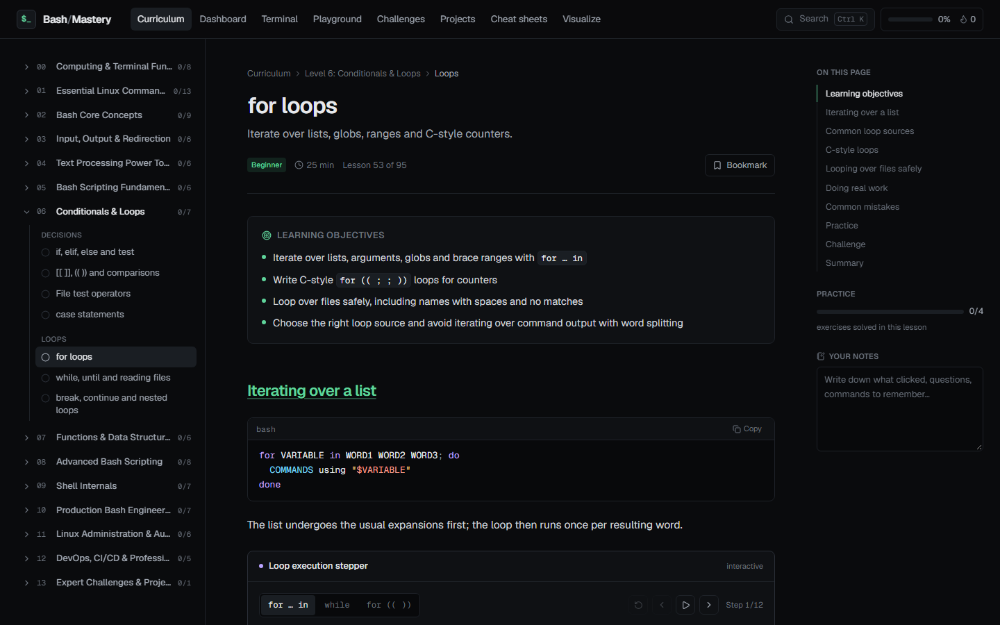

### A real-feeling terminal — running entirely in your browser

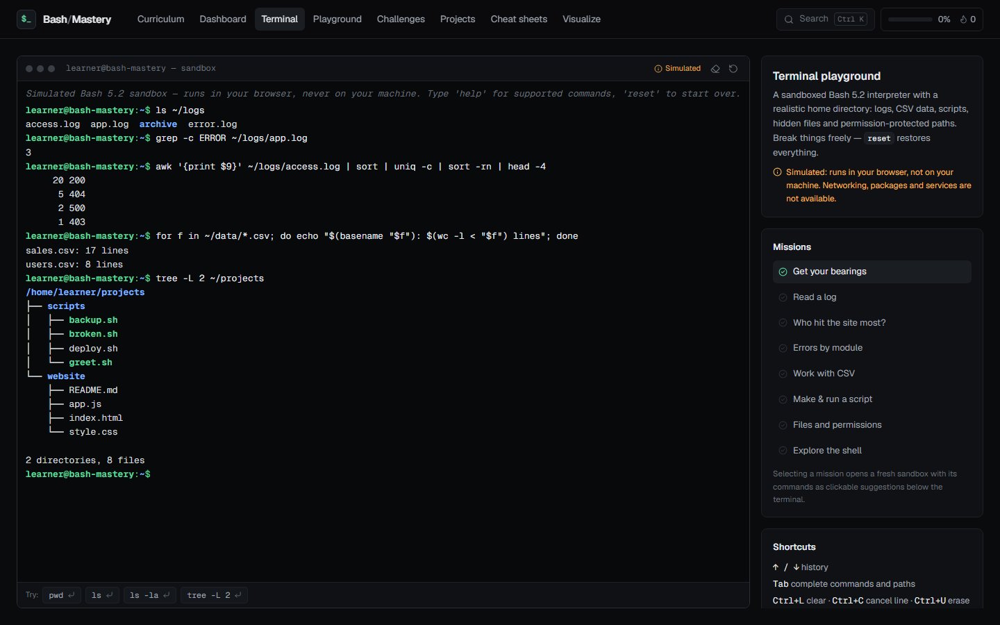

### Code playground

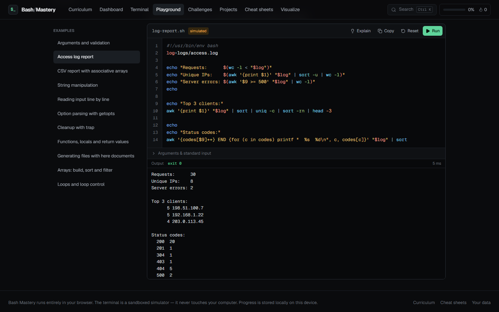

### Exercises that check your answer by running it

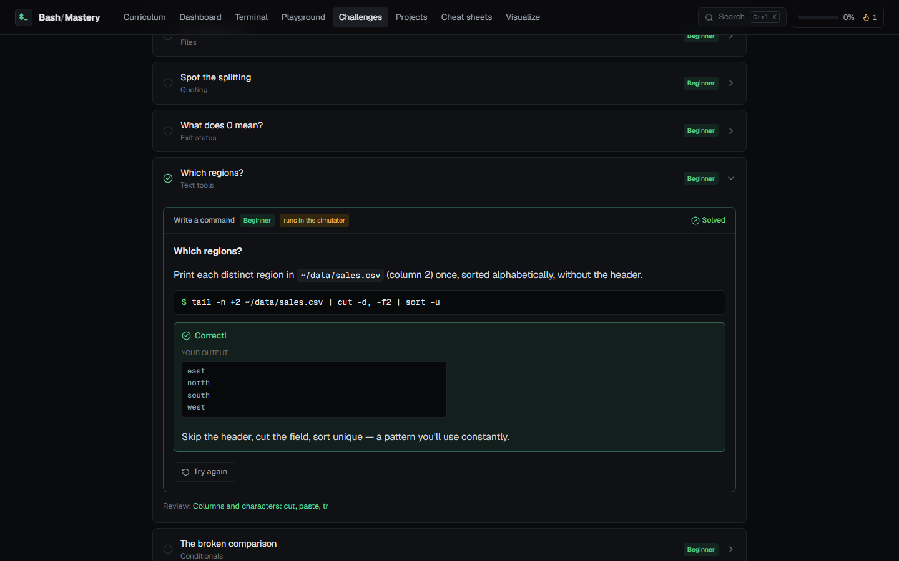

<table>
  <tr>
    <td width="50%"><b>Interactive visualizations</b><br>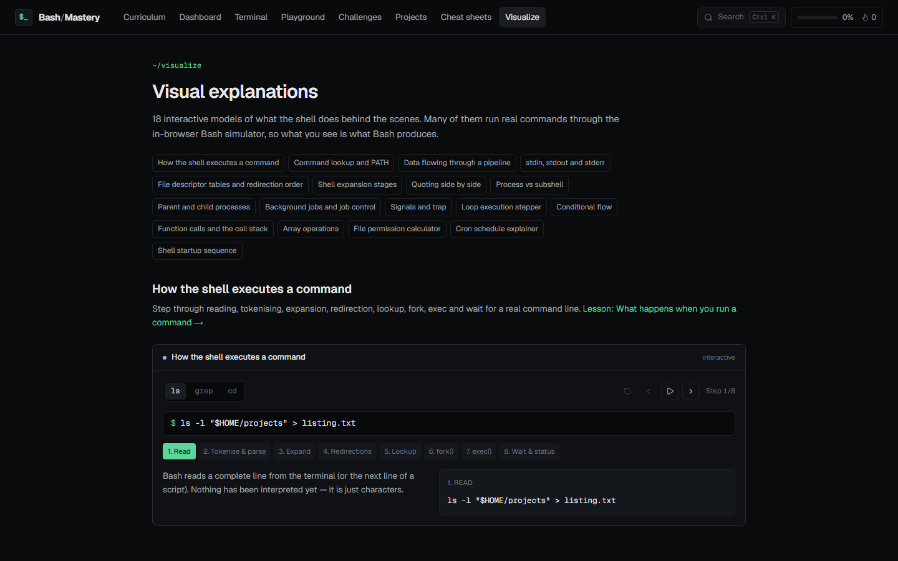</td>
    <td width="50%"><b>Guided projects</b><br>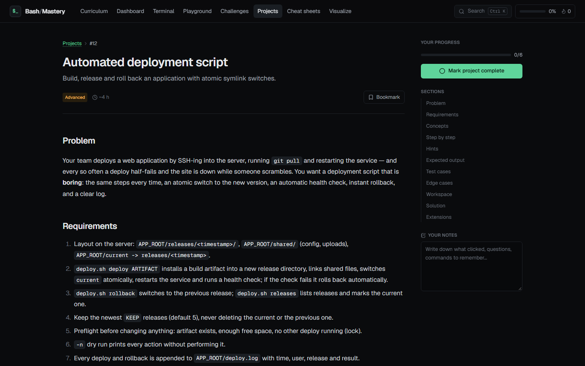</td>
  </tr>
  <tr>
    <td width="50%"><b>Search everything with Ctrl + K</b><br>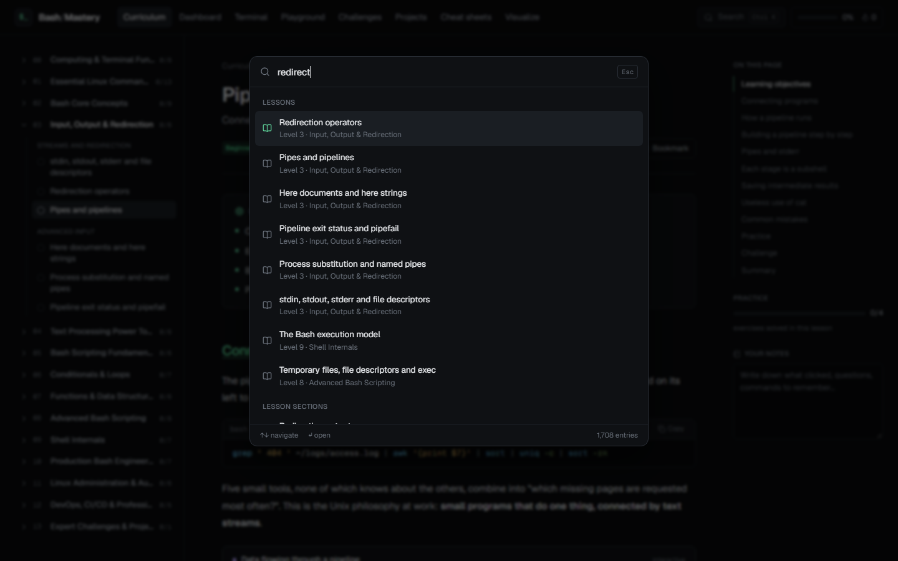</td>
    <td width="50%"><b>Searchable cheat sheets</b><br>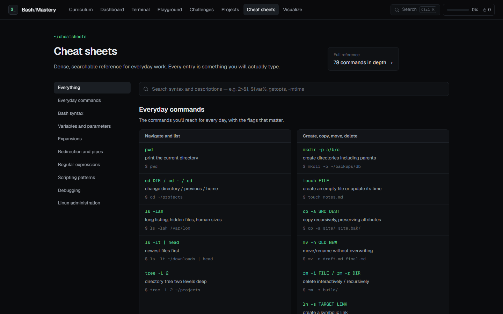</td>
  </tr>
  <tr>
    <td width="50%"><b>Curriculum explorer</b><br>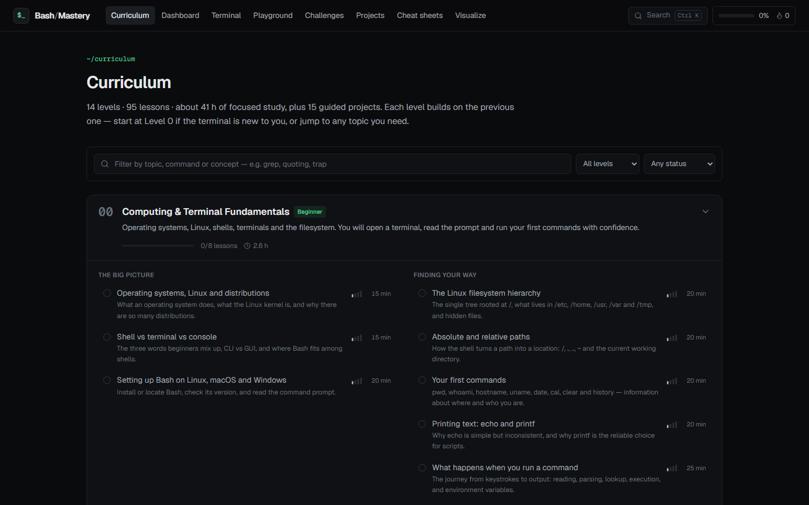</td>
    <td width="50%">
      <b>Works on mobile</b><br>
      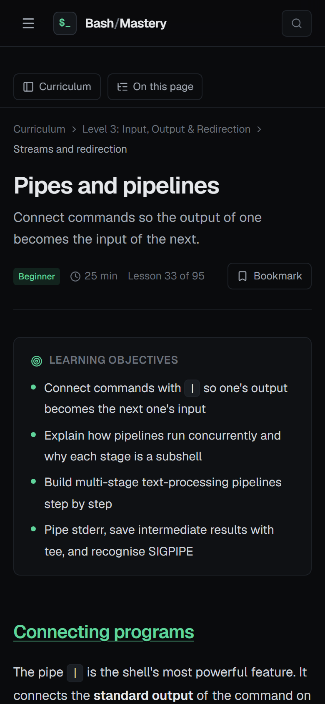
      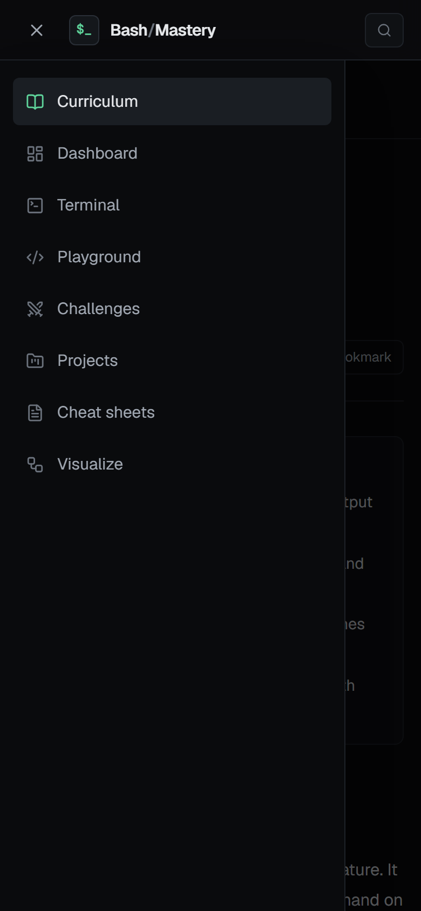
    </td>
  </tr>
</table>

## Curriculum

| Level | Topic | What you'll learn |
|---|---|---|
| 0 | Computing & terminal fundamentals | Operating systems, shell vs terminal vs console, the Linux filesystem, paths |
| 1 | Essential Linux commands | Navigating, creating, copying, reading, finding files and commands, `grep`, `sort`, `cut`, `xargs` |
| 2 | Bash core concepts | Anatomy of a command, quoting, exit status, command lists, expansion order, globbing |
| 3 | Input, output & redirection | Streams, file descriptors, pipes, here-documents, process substitution, `pipefail` |
| 4 | Text processing power tools | Regular expressions, `grep` in depth, `sed`, `awk`, log parsing |
| 5 | Scripting fundamentals | First scripts, variables, environment, arguments, input, exit codes |
| 6 | Conditionals & loops | `if`, `[[ ]]`, `(( ))`, file tests, `case`, `for`, `while`, loop control |
| 7 | Functions & data structures | Functions, scope, indexed and associative arrays, parameter expansion, namerefs |
| 8 | Advanced Bash scripting | Subshells, job control, signals and `trap`, file descriptors, `getopts`, error handling, debugging |
| 9 | Shell internals | Execution model, command lookup, environment inheritance, startup files, process groups, buffering |
| 10 | Production Bash engineering | Script architecture, logging and config, security, atomicity, portability, performance, testing |
| 11 | Linux administration | Permissions, processes and services, disk/memory/CPU, networking and SSH, cron, backups |
| 12 | DevOps & CI/CD | Git and Docker automation, CI/CD scripts, deployments, production operations |
| 13 | Expert projects | A repeatable process for scripting projects, plus 15 guided projects |

<details>
<summary><b>The 15 projects</b></summary>

1. Personal file organizer
2. Automated backup utility
3. Bulk file renaming tool
4. Log analyzer
5. Disk usage monitor
6. System health monitoring script
7. Automated cleanup utility
8. Interactive menu-driven CLI
9. Password generator
10. Bulk CSV processor
11. Git repository management utility
12. Automated deployment script
13. Multi-server backup manager
14. Process monitoring utility
15. Production-grade CLI application

</details>

## Getting started

**Requirements:** Node.js 20.9 or newer (developed on Node 24) and npm.

```bash
git clone https://github.com/<your-username>/bash-mastery.git
cd bash-mastery
npm install
npm run dev
```

Then open <http://localhost:3000>.

| Script | Purpose |
|---|---|
| `npm run dev` | Start the development server (Turbopack) |
| `npm run build` | Production build — pre-renders all 126 pages |
| `npm start` | Serve the production build |
| `npm test` | Run the simulator and content test suites (Vitest) |
| `npm run typecheck` | Generate route types and run `tsc` |
| `npm run lint` | Run ESLint |

The site has no backend and no environment variables, so it deploys as-is to Vercel or any host that runs Next.js.

## How it works

```text
Markdown + YAML content ──▶ build-time parser ──▶ statically rendered lesson pages
                                                        │
                       ┌────────────────────────────────┼──────────────────────────────┐
                       ▼                                ▼                              ▼
              Terminal & playground            Exercises & challenges           Visualizations
                       │                                │                              │
                       └──────────────▶  TypeScript Bash interpreter  ◀───────────────┘
                                        (parser → expansion → executor)
                                                        │
                                          In-memory virtual filesystem
```

- **The simulator** (`src/lib/shell`) is a from-scratch interpreter: a recursive-descent parser builds an AST, an expansion engine applies Bash's expansion steps in order (brace → tilde → parameter/arithmetic/command substitution → word splitting → globbing → quote removal), and an executor runs builtins, functions, pipelines, subshells and redirections against an in-memory filesystem with users, permissions and symlinks. Commands such as `awk`, `sed`, `grep`, `find` and `sort` are implemented in TypeScript, and a step budget stops infinite loops.
- **Content** lives in plain Markdown with YAML front matter and fenced blocks (`exercise`, `mistake`, `compare`, `bash playground`, `::viz`). It is parsed and validated at build time, so a malformed exercise fails the build instead of reaching learners.
- **Pages** are statically pre-rendered React Server Components (Next.js App Router with Cache Components). Heavy client widgets — terminal, editor, visualizations — load lazily when they come near the viewport.
- **Progress** is stored in `localStorage` under a versioned key, read through `useSyncExternalStore`, and repaired automatically if it's ever corrupted.

## Project structure

```text
src/
├── app/                    # Routes: home, learn/[slug], terminal, playground, visualize,
│                           # challenges, projects/[slug], cheatsheets, dashboard, search index
├── components/             # UI: lesson blocks, exercises, terminal, editor, viz, search, shell
├── content/
│   ├── curriculum.ts       # Levels → modules → lessons outline
│   ├── lessons/*.md        # 95 lessons
│   ├── projects/*.md       # 15 projects
│   ├── commands/*.yaml     # Command reference docs
│   ├── challenges.yaml     # Standalone challenges
│   └── cheatsheets.yaml    # Cheat sheet sections
├── lib/
│   ├── shell/              # The Bash interpreter, virtual filesystem and commands
│   ├── content/            # Markdown/YAML parsing and validation
│   └── progress/           # Local progress store and hooks
└── test/                   # Content verification tests
```

## Writing content

Lessons are Markdown files in `src/content/lessons/`, named after their slug in `curriculum.ts`. A short example:

````markdown
---
objectives:
  - Iterate over lists with `for … in`
summary:
  - "`for var in LIST; do …; done` runs the body once per word."
related:
  - while-and-until
---

## Iterating over a list

::viz loops

```bash title="lists.sh" playground
for env in dev staging prod; do echo "deploying to $env"; done
```

## Practice

```exercise
kind: command
difficulty: beginner
prompt: "Print the name of every `.sh` file in `~/projects/scripts`."
solution: for f in ~/projects/scripts/*.sh; do echo "${f##*/}"; done
explanation: "`${f##*/}` strips the directory."
```
````

Run `npm test` after editing. The content tests execute every reference answer in the simulator and fail if an expected output, a predicted answer or a playground example doesn't match what Bash would produce.

## Testing

```bash
npm test
```

- **Simulator tests** cover parsing, expansion, quoting, redirection, arithmetic, traps and commands.
- **Content tests** verify all 95 lessons, 15 projects, 31 challenges and the cheat sheets: every exercise solution and expected output is checked by running it, every runnable example must run cleanly, and every cross-reference must resolve.

## Contributing

Contributions are welcome — new exercises, clearer explanations, more simulator commands and bug fixes alike.

1. Fork the repository and create a branch.
2. Make your change and run `npm test`, `npm run lint` and `npm run typecheck`.
3. Open a pull request describing what you changed and why.

If the simulator behaves differently from real Bash, please open an issue with the command, the expected output from `bash --version` 5.x, and what the simulator printed.

---

<div align="center">
Built for people who want to understand the shell, not just copy commands.
</div>
